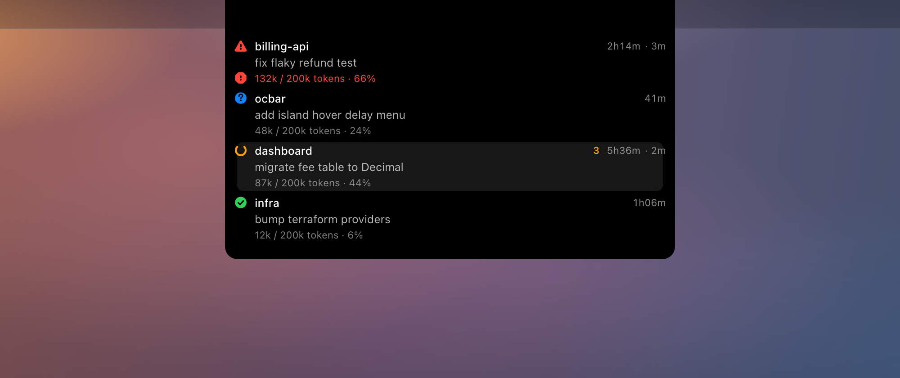

# ocbar

macOS menubar app that monitors [OpenCode](https://opencode.ai) sessions across all your terminals.




> **OpenCode v2 required.** ocbar targets OpenCode v2 only. v1 users should use git tag `oc_v1` (`git checkout oc_v1`), the last v1-compatible version.

## Features

- **Menubar label** — one colored status icon plus project folder name per session, up to a configurable maximum. Overflow folds into a single `✓ n idle`.
- **Icon color** — orange while all sessions are busy, green when at least one is idle, red if any errored, gray when OpenCode isn't running.
- **Click** for a per-session menu with status, optional age and titles.
- **Context usage** (off by default) — how full each session's context window is, with configurable format and warning thresholds.
- **Notification and bubble** — firing on busy → idle or → waiting. The bubble shows the project and status, holds 10s, and jumps to that session's tmux pane on click.
- **Island** (on by default) — a status capsule at the top of every display: a ring and running count on the left, one icon-and-count badge per waiting/finished/errored state on the right. Hover to expand into a session list you can click. With the bubble off, it takes over as the reminder.

Alert sound, bubble position, and per-surface toggles live in the menu.

## How it works

Reads `~/.local/state/opencode/service.json` to find the shared OpenCode service, then polls it over HTTP (2s for liveness, 0.5s for sessions). Sessions appear once the exact session id is bound to a live `opencode` client — reported live by the `ocbar-bridge` TUI plugin, with `ps` argv as fallback — so subagent children and orphaned sessions stay hidden.

## Limitations

- **Session binding needs the bridge plugin.** OpenCode v2's HTTP API exposes no client identity, so `build.sh` installs `ocbar-bridge` into `~/.config/opencode/plugins/`. Without it, ocbar falls back to the argv snapshot and won't follow session switches inside a TUI.
- **A client appears only after its first message** — sessions are created lazily.
- **Bubbles and notifications are keyed by project** — one popup per directory.

## Requirements

- macOS 13+
- [OpenCode](https://opencode.ai) v2 installed
- Xcode Command Line Tools (`xcode-select --install`)

## Build & run

```bash
git clone https://github.com/CurtisNewbie/ocbar.git
cd ocbar
./build.sh
```

`build.sh` compiles the Swift sources, bundles `ocbar/ocbar.app`, installs the `ocbar-bridge` TUI plugin, then installs to `~/Applications/ocbar.app` and launches it. It is the only build path — Xcode is not used. Re-run it to rebuild and relaunch.

Allow notifications when macOS prompts; idle alerts need them. If macOS blocks the app, open **System Settings → Privacy & Security** and click **Open Anyway**.

## Development

`AGENTS.md` covers the build invariants. `docs/` holds one file per subsystem, each recording the invariants a change there could break.